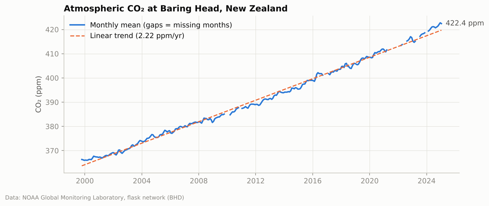
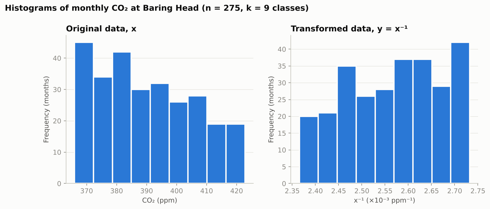
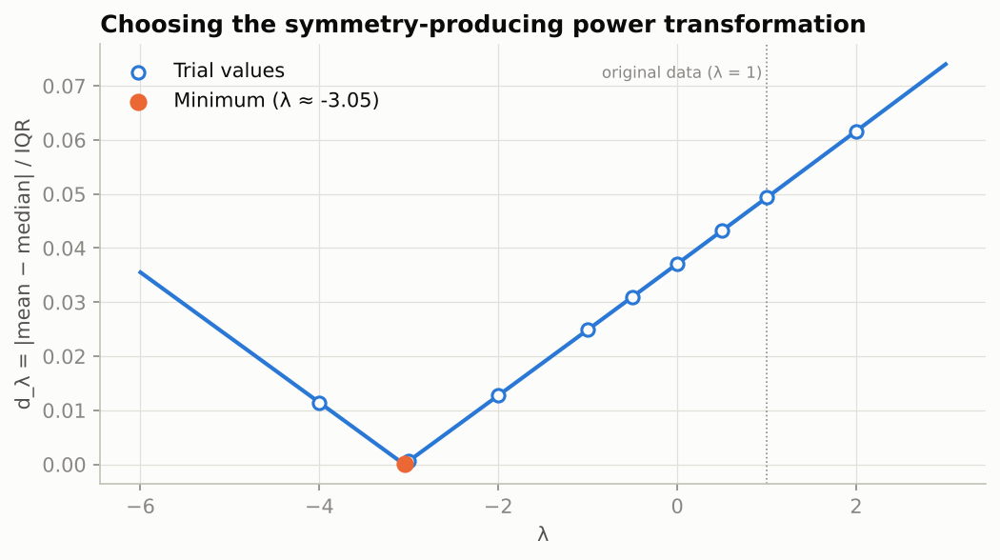
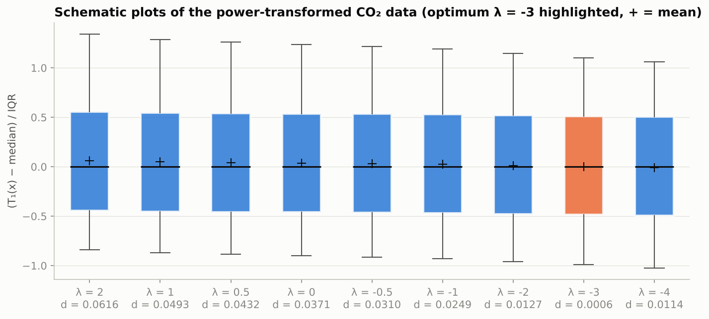

# Atmospheric CO₂ at Baring Head: Summary Measures & Reexpression

Statistical analysis of **monthly atmospheric CO₂ at Baring Head (BHD), New Zealand**, a clean-air Southern Hemisphere background station, from **October 1999 to January 2025** (n = 275 months).



## ❓ Questions
1. What is the most representative "mean level" of the CO₂ record, and how skewed is it? *(Homework 1)*
2. Which power transformation makes the distribution symmetric, and what causes the skewness? *(Homework 2)*

## 📊 Data
| | |
|---|---|
| Variable | Monthly CO₂ dry-air mole fraction (ppm) |
| Station | Baring Head (BHD), New Zealand |
| Period | Oct 1999 – Jan 2025 (304 months, 29 missing → n = 275) |
| Source | [NOAA Global Monitoring Laboratory, surface flask network](https://gml.noaa.gov/aftp/data/trace_gases/co2/flask/surface/txt/co2_bhd_surface-flask_1_ccgg_month.txt) |

## 📈 Key findings
- **Steady rise:** CO₂ increased from 366 ppm (1999) to 422 ppm (2024), about **2.2 ppm/year** on average, and the rate grows over time (≈2.0 → 2.6 ppm/yr from 1999–2009 to 2018–2025).
- **Mean level:** all Type I means fall within 1 ppm (harmonic 389.50, geometric 389.82, arithmetic 390.15, quadratic 390.47 ppm). That is because relative dispersion is small (C_v ≈ 0.04).
- **Skewness:** the distribution is weakly **positively skewed** (Pearson S = 0.244, Yule–Kendall γ = 0.093, C_s = 0.257). Of the Type I means, the **harmonic mean** is the best one, because x⁻¹ is the least skewed.
- **Reexpression:** the d_λ statistic is smallest at **λ = −3** (d = 0.0006, about 78× smaller than for the raw data). λ = −4 over-corrects.
- **Interpretation:** no point lies outside the inner fences, so the skewness doesn't come from outliers. It comes from the **accelerating upward trend**: higher CO₂ levels are reached faster in recent years. For climatological work, removing the trend and seasonal cycle before analysing anomalies would make more sense than a −x⁻³ transform.

| Homework 1: Histograms | Homework 2: Choosing λ |
|---|---|
|  |  |



## 🔧 Methods
- **Homework 1, Numerical summary measures:** power means M₋₁, M₀, M₁, M₂; median; 10% trimmed mean; Pearson, Yule–Kendall and moment skewness of xʳ; histograms (k = 1 + 3.3 log₁₀ n).
- **Homework 2, Graphical summary & reexpression:** five-number summary, schematic plot with inner/outer fences, order-preserving power transformation T₁(x), d_λ = |mean − median| / IQR on trial values and a fine λ grid.

The original analysis was done in Excel. This repository reproduces every result in Python, and all numbers match the submitted reports.

## 📁 Repository structure
```
├── data/co2_bhd_monthly.csv        raw monthly data (NOAA GML)
├── src/co2stats.py                 reusable statistics functions
├── src/plotstyle.py                shared figure style
├── scripts/hw1_summary_measures.py Homework 1
├── scripts/hw2_reexpression.py     Homework 2
├── results/                        output tables (CSV)
└── figures/                        output figures (PNG)
```

## ▶️ How to run
```bash
pip install -r requirements.txt
python scripts/hw1_summary_measures.py
python scripts/hw2_reexpression.py
```

## 👩‍💻 Author
**Cansu Yamanlar**, MTO 311E Data Analysis, Istanbul Technical University (Fall 2026)
[GitHub profile](https://github.com/cyamanlar)
